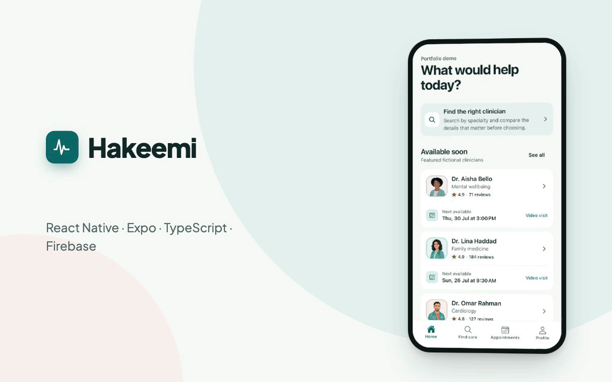
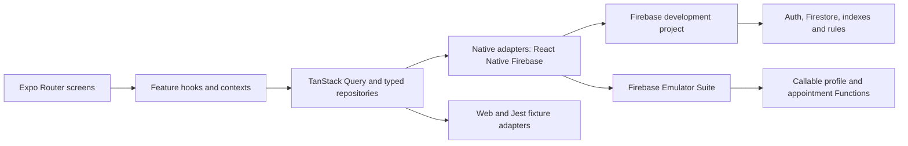

# Hakeemi

**A production-shaped React Native appointment experience, rebuilt from a 2021 portfolio app with modern Expo and Firebase architecture.**

> Hakeemi is a technical portfolio project. It uses fictional clinicians and
> patient data and is not a healthcare service or clinical product.

<p align="center">
  
</p>

<p align="center">
  <a href="docs/hakeemi-promo.mp4"><strong>▶ Watch the full 70-second promo with sound</strong></a>
  · built with <a href="video/">Remotion</a> from real simulator captures
</p>

| Illustrated welcome                                                                                                                      | Discovery with portraits                                                                                                                 | Provider profile                                                                                                                                  |
| ---------------------------------------------------------------------------------------------------------------------------------------- | ---------------------------------------------------------------------------------------------------------------------------------------- | ------------------------------------------------------------------------------------------------------------------------------------------------- |
|  |  |  |

| Arabic RTL discovery                                                                                                                     | Dark mode, Arabic                                                                                       | Account preferences                                                                                                                    |
| ---------------------------------------------------------------------------------------------------------------------------------------- | ------------------------------------------------------------------------------------------------------- | -------------------------------------------------------------------------------------------------------------------------------------- |
|  |  |  |

## The rebuild

The original Hakeemi was a bare React Native 0.64 app from 2021, preserved
under the [`legacy-v1`](https://github.com/naderalfakesh/Hakeemi/tree/legacy-v1)
tag. The rebuild replaces it with Expo SDK 57, React Native 0.86, React 19.2,
TypeScript, Expo Router, and native React Native Firebase — not an Expo Go
prototype, but development builds with Continuous Native Generation and EAS
profiles ([ADR 0001](docs/adr/0001-expo-cng.md)). The work landed as small,
independently reviewable commits; the [roadmap](docs/ROADMAP.md) records the
sequence and current position.

## Features

- Four-step onboarding with RTL and reduced-motion support, a signed-out
  Welcome entry, and typed four-tab Expo Router navigation
- Provider discovery backed by Firestore: search, specialty filters, cursor
  pagination, and a two-week availability calendar
- Email/password accounts with verification, password recovery, and cold-start
  session restoration; profiles are server-owned and created by an idempotent
  callable Function
- Transactional booking plus atomic cancellation and rescheduling through
  Cloud Functions that prevent double-booking and keep all lifecycle writes
  server-controlled
- Account-free Explore Demo with seeded appointments in an isolated on-device
  repository
- Calendar export, opt-in privacy-safe appointment reminders over FCM, and
  restrained haptics — each behind a platform adapter with deterministic
  web/Jest fixtures
- Saved clinicians and synchronized language/theme preferences with optimistic
  updates and rollback
- Full Arabic localization: typed bilingual string catalogs, bilingual provider
  data, CLDR plural rules, native RTL layout with mirrored navigation,
  offline-aware cached reads, Dynamic Type up to 2×, and 44 pt touch targets

Spoken VoiceOver/TalkBack passes, Android-hardware E2E, and the native
permission dialogs remain for interactive release sign-off.

## Architecture



Feature code owns domain types and behavior; platform adapters own SDK details.
Zod validates Firestore data at the boundary, TanStack Query owns server state,
and one application-level session owner handles authentication. The backend is
the isolated `hakeemi-portfolio-dev` project; Cloud Functions and Storage stay
emulator-only until enabling billing is an explicit decision.

## Technology

| Area                 | Choice                                                                                                      |
| -------------------- | ----------------------------------------------------------------------------------------------------------- |
| Runtime              | Expo SDK 57, React Native 0.86, React 19.2, New Architecture                                                |
| Navigation           | Expo Router with typed routes and static web export                                                         |
| Native services      | React Native Firebase App, Auth, Firestore, Functions, Messaging; Expo Calendar, Notifications, and Haptics |
| Server state         | TanStack Query with stable keys, retries, caching, and cursor pages                                         |
| Forms and validation | React Hook Form and Zod                                                                                     |
| Backend              | Firebase Auth, Firestore, Cloud Functions, Security Rules, Emulator Suite                                   |
| Quality              | Strict TypeScript, Jest, React Native Testing Library, ESLint, Prettier, Expo Doctor                        |
| Native lifecycle     | Expo CNG, config plugins, development builds, and EAS profiles                                              |

## Quality

CI runs `npm run validate` — formatting, lint, strict types, 39 Jest suites
with 121 tests (including Arabic-locale renders), CI-enforced illustration
budgets, and Expo Doctor — plus the Firebase emulator matrix: 14 security-rules
tests and callable integration suites for booking, appointment management,
notification tokens, and scheduled reminders. Native evidence includes iOS and
iPad development builds, an Android arm64 APK, and the static web export.
The [testing strategy](docs/testing-strategy.md), per-phase verification
records, and the privacy-safe [analytics contract](docs/analytics-events.md)
live under [`docs/`](docs/).

## Project structure

```text
src/app/                 Expo Router routes
src/components/ui/       Accessible design-system primitives
src/features/            Feature-owned UI, domain, data, and tests
src/services/            Firebase initialization and query infrastructure
src/theme/               Tokens, themes, navigation theme, contrast checks
firebase/                Rules, indexes, seed catalogue, integration tests
functions/src/           TypeScript callable backend and seed tooling
docs/                    Roadmap, ADRs, verification evidence, backend guide
```

## Run locally

Local development runs entirely against the Firebase Emulator Suite —
**no Firebase account, project, or credentials are required**. Native builds
fall back to committed emulator-only placeholder Google service files when no
real configuration is present.

Prerequisites: Node.js 22.13+ (below 25), npm, a Java runtime (JDK 17+) for
the emulators, plus Xcode/CocoaPods for iOS and Android Studio with an SDK and
JDK for Android.

```sh
npm install
npm --prefix functions install
cp .env.example .env
npm run validate
```

Start the local Firebase backend in one terminal and keep it running:

```sh
npm run firebase:emulators:seeded
```

A fresh clone starts clean and is seeded with the fictional catalogue
automatically; emulator state is exported on exit and reused, with appointment
dates rolled forward to today, on later runs.

Then build and run the app:

```sh
npx expo prebuild --clean
npm run ios
# or
npm run android
```

`.env.example` enables emulator mode, so accounts, discovery, booking, and
appointment management all work locally; only push-notification registration
needs a real Firebase project. Expo Go is not a supported runtime. To target
your own Firebase project instead, drop its service files under
`.firebase/development/` and rebuild — the
[Firebase development guide](docs/firebase-development.md) covers the
resolution order, emulator namespaces, service ports, and deployment
safeguards.

| Command                           | Purpose                                                    |
| --------------------------------- | ---------------------------------------------------------- |
| `npm start`                       | Start Metro for the Expo development client                |
| `npm run ios` / `npm run android` | Generate and run a native build                            |
| `npm run web`                     | Run the static-compatible web portfolio build              |
| `npm test`                        | Run application tests                                      |
| `npm run firebase:rules:test`     | Verify Firestore and Storage authorization                 |
| `npm run validate`                | Run formatting, lint, strict types, tests, and Expo Doctor |

## Historical context

The 2021 app was based on a free
[Doctor Appointment App Community design](https://www.figma.com/file/t9IGYhQmBToThHPtxJUuz5/Doctor-Appointment-App-Community?node-id=0%3A1);
its visual assets are reference-only because no license was retained. The
modern interface and screenshots are newly implemented, and the
[legacy baseline](docs/legacy-baseline.md) records provenance and the original
architecture audit.

## Contributing and license

Contributions follow [CONTRIBUTING.md](CONTRIBUTING.md) — fictional data only,
single-line conventional commits, and `npm run validate` before review. The
code is available under the [MIT License](LICENSE).
