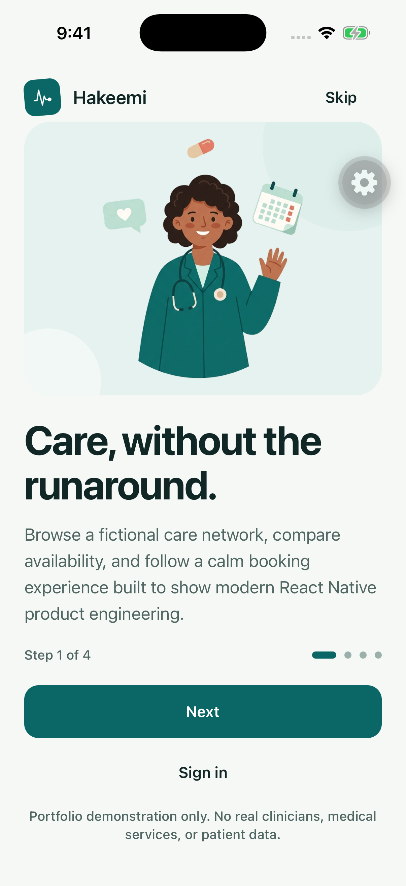
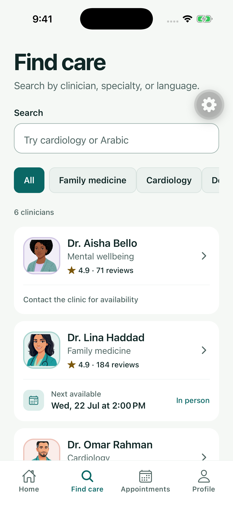
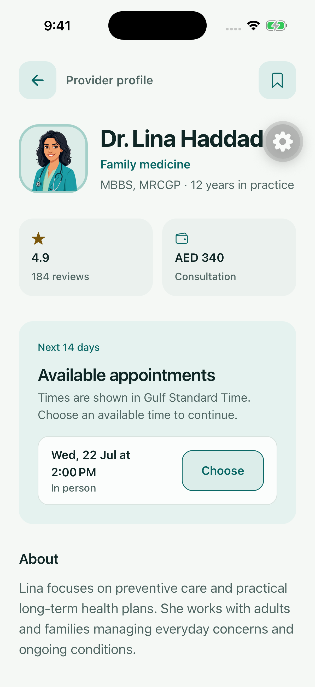
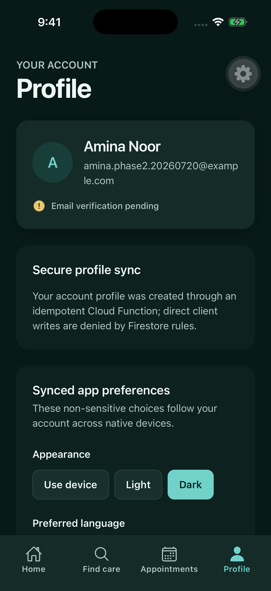
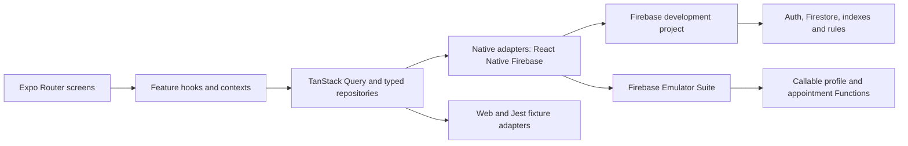

# Hakeemi

**A production-shaped React Native appointment experience, rebuilt from a 2021 portfolio app with modern Expo and Firebase architecture.**

> Hakeemi is a technical portfolio project. It uses fictional clinicians and
> patient data and is not a healthcare service or clinical product.

| Illustrated welcome                                                                                                                      | Discovery with portraits                                                                                                                 | Provider profile                                                                                                                                  |
| ---------------------------------------------------------------------------------------------------------------------------------------- | ---------------------------------------------------------------------------------------------------------------------------------------- | ------------------------------------------------------------------------------------------------------------------------------------------------- |
|  |  |  |

| Arabic RTL discovery                                                                                                                     | Dark mode, Arabic                                                                                       | Account preferences                                                                                                                    |
| ---------------------------------------------------------------------------------------------------------------------------------------- | ------------------------------------------------------------------------------------------------------- | -------------------------------------------------------------------------------------------------------------------------------------- |
|  |  |  |

## The rebuild

The original Hakeemi was a bare React Native 0.64 application created in 2021.
This rebuild preserves that history in the
[`legacy-v1`](https://github.com/naderalfakesh/Hakeemi/tree/legacy-v1) tag while
replacing the implementation with Expo SDK 57, React Native 0.86, React 19.2,
TypeScript, Expo Router, and native Firebase SDKs.

This is not an Expo Go prototype. Hakeemi uses an Expo development build,
React Native Firebase, CocoaPods and Gradle native builds, Continuous Native
Generation (CNG), and explicit EAS build profiles. Expo removes unnecessary
generated-project maintenance without removing native capability. The full
trade-off and escape hatch are recorded in
[`ADR 0001`](docs/adr/0001-expo-cng.md).

The modernization is delivered as small, independently reviewable commits.
Phases 0–4 are complete — discovery, accounts, transactional booking, and
appointment management, including a native iOS book→reschedule→cancel journey
recorded with screenshots. Phase 5 shipped full Arabic localization with
native RTL layout, bilingual provider data, offline-aware caching, and
accessibility polish; spoken VoiceOver/TalkBack passes on hardware are the
remaining sign-off. See the [roadmap](docs/ROADMAP.md) for the complete
sequence.

## What works today

- A first-run, four-step onboarding sequence with button and swipe navigation,
  native horizontal page transitions, RTL direction support, and a
  reduced-motion fallback. Completion is persisted; returning signed-out users
  land on a separate Welcome screen that owns demo, sign-in, and account-creation
  choices. Four-tab navigation is built with typed Expo Router routes.
- Provider search, specialty filters, stable cursor pagination, and provider
  details backed by Firestore on native platforms. Provider profiles now expose
  a two-week availability calendar with unavailable days, day-specific time
  choices, visit modes, and an explicit continue action.
- Email/password sign-up, sign-in, password recovery, verification handoff,
  sign-out, and cold-start session restoration.
- A callable Function that creates the authenticated user's server-owned
  profile idempotently.
- An authenticated, idempotent booking Function that prevents two requests from
  reserving the same slot in tested Firestore transactions.
- Explore Demo is a persistent, account-free session with seeded upcoming,
  completed, and cancelled appointments. Demo booking and management use an
  isolated on-device repository, while authenticated writes continue through
  the secure Firebase Functions boundary.
- Authenticated appointment management with atomic cancellation and
  same-provider rescheduling, a 15-minute lead-time policy, audit timestamps,
  and server-only idempotency receipts.
- Upcoming, past, cancelled, and deep-linkable appointment detail screens with
  offline-aware lifecycle actions and safe reschedule choices.
- Confirmed appointment details can request calendar access and add a
  non-sensitive event through the native Expo calendar adapter; web and Jest
  use deterministic unavailable adapters.
- The Profile screen offers optional appointment reminders; native FCM tokens
  register through a callable Function, refresh safely, and route typed
  appointment reminder taps to appointment details. Web/Jest stay unavailable
  by design.
- A scheduled Cloud Function sends generic, privacy-safe appointment reminders
  in a 24-hour window, records an idempotent delivery receipt, and disables
  invalid device tokens without putting provider, patient, or appointment
  details in FCM payloads or logs.
- Successful booking and destructive appointment confirmation use restrained
  native haptics with deterministic web/Jest no-op adapters.
- Authenticated users can save active clinicians to an owner-only Firestore
  subcollection, toggle the bookmark from a provider profile, and manage the
  shortlist from Profile.
- Owner-only language and theme preferences with optimistic updates, rollback,
  Firestore synchronization, and live dark-mode application.
- Full Arabic localization: every screen reads from typed bilingual string
  catalogs (including accessibility labels and validation messages), provider
  catalog data is bilingual with English fallback, plural rules follow CLDR
  even where Hermes lacks `Intl.PluralRules`, and selecting Arabic persists a
  native RTL layout with mirrored navigation and directional icons.
- Offline-aware reads: discovery and appointments keep serving cached results
  when a refresh fails and announce staleness through a localized, polite live
  region; bookings are still never queued offline.
- Dynamic Type up to a 2× cap with intact layouts, reduced-motion-aware
  navigation transitions, localized accessibility hints on destructive
  actions, and 44 pt touch targets.
- Deterministic fictional seed data, default-deny Firebase rules, composite
  indexes, and repeatable Emulator Suite tests.
- Explicit fixture adapters for Jest and the static web portfolio export; no
  native SDK is silently replaced on iOS or Android.

Spoken VoiceOver/TalkBack passes, Android-hardware E2E, and the
calendar/notification permission dialogs still need an interactive
release-signoff run on devices.

## Architecture



Feature code owns domain types and behavior; platform adapters own SDK details.
Zod validates Firestore data at the boundary, TanStack Query owns server state,
and route parameters contain stable serializable IDs. Authentication has one
application-level session owner instead of screen-level subscriptions.

The backend uses a separate development project,
`hakeemi-portfolio-dev`. The undocumented legacy Firebase project is
intentionally untouched. Cloud Functions and Storage remain emulator-only
until enabling Firebase billing is an explicit decision.

## Technology

| Area                 | Choice                                                                                                      |
| -------------------- | ----------------------------------------------------------------------------------------------------------- |
| Runtime              | Expo SDK 57, React Native 0.86, React 19.2, New Architecture                                                |
| Navigation           | Expo Router with typed routes and static web export                                                         |
| Native services      | React Native Firebase App, Auth, Firestore, Functions, Messaging; Expo Calendar, Notifications, and Haptics |
| Server state         | TanStack Query with stable keys, retries, caching, and cursor pages                                         |
| Forms and validation | React Hook Form and Zod                                                                                     |
| Backend              | Firebase Auth, Firestore, Cloud Functions, Security Rules, Emulator Suite                                   |
| Quality              | Strict TypeScript, Jest, React Native Testing Library, ESLint, Prettier, Expo Doctor                        |
| Native lifecycle     | Expo CNG, config plugins, development builds, and EAS profiles                                              |

## Quality evidence

The current milestone has been exercised beyond unit tests:

- iOS CNG development build: successful, with native Firebase modules linked;
  interactive Arabic/RTL and management journeys recorded on the simulator,
  and the same build verified on an iPad simulator.
- Android arm64 debug APK: successful.
- Static web export: 21 routes generated, including appointment detail.
- Application tests: 34 suites and 108 tests passing, including Arabic-locale
  renders for every screen area.
- Illustration payload: 16 WebP assets at 819.1 KB total, reduced from roughly
  4.6 MB and protected by CI budgets of 150 KB per file and 1 MB total.
- Firebase authorization: 14 Emulator Suite rules tests passing.
- Callable integration: booking, appointment-management, notification-token,
  and scheduled-reminder Auth, Firestore, Pub/Sub, and Functions emulator
  suites passing.
- Strict type checks: application, Firebase tooling, and Functions passing.
- Expo Doctor: 20/20 checks passing.

The [testing strategy](docs/testing-strategy.md) defines the test pyramid and
the critical-path coverage gate, and [analytics events](docs/analytics-events.md)
fixes the privacy-safe telemetry contract before any instrumentation exists.

The [Phase 2 verification record](docs/phase-2-verification.md) includes the
tested flows, environment boundaries, cleanup, screenshots, and known
non-blocking warnings. [Phase 1 evidence](docs/phase-1-verification.md) records
the rebuilt UI foundation and native baseline. The [Phase 4 record](docs/phase-4-verification.md)
and [Phase 5 foundation record](docs/phase-5-verification.md) document the
appointment follow-through and inclusive/resilient platform work. The [Phase 6
record](docs/phase-6-verification.md) documents the CI and EAS release boundary.

## Project structure

```text
src/app/                 Expo Router routes
src/components/ui/       Accessible design-system primitives
src/features/            Feature-owned UI, domain, data, and tests
src/services/            Firebase initialization and query infrastructure
src/theme/               Tokens, themes, navigation theme, contrast checks
firebase/                Rules, indexes, seed catalogue, integration tests
functions/src/           TypeScript callable backend and seed tooling
docs/                    Roadmap, ADRs, verification evidence, backend guide
```

## Run locally

### Prerequisites

- Node.js 22.13 or newer and earlier than 25
- npm
- Xcode and CocoaPods for iOS development
- Android Studio, an Android SDK, and a compatible JDK for Android development

Install both workspaces and validate the repository:

```sh
npm install
npm --prefix functions install
cp .env.example .env
npm run validate
```

Native Firebase service files are deliberately not committed. Place your
development files at `.firebase/development/GoogleService-Info.plist` and
`.firebase/development/google-services.json`, or provide their paths through
the environment variables documented in `.env.example`.

Generate and run a native development build:

```sh
npx expo prebuild --clean
npm run ios
# or
npm run android
```

Start Metro for an existing development client with `npm start`. Expo Go is not
a supported runtime after React Native Firebase is linked.

### Firebase emulators

Start the local services in one terminal:

```sh
npm run firebase:emulators:seeded
```

The seeded command imports saved emulator state and automatically refreshes the
fictional appointment dates for today without reopening confirmed reservations.
If an already-running clean emulator needs data, seed it from another terminal:

```sh
npm run firebase:seed:emulator
```

Interactive emulators use `hakeemi-portfolio-dev` so their namespace matches the
ignored native Firebase configuration. Automated authorization and contention
tests still use the reserved `demo-hakeemi` project. Cloud commands must always
name `hakeemi-portfolio-dev` explicitly; the repository does not contain a
`.firebaserc`. The
[Firebase development guide](docs/firebase-development.md) documents service
ports, deployment safeguards, native configuration, and the billing boundary.

## Useful commands

| Command                           | Purpose                                                    |
| --------------------------------- | ---------------------------------------------------------- |
| `npm start`                       | Start Metro for the Expo development client                |
| `npm run ios` / `npm run android` | Generate and run a native build                            |
| `npm run web`                     | Run the static-compatible web portfolio build              |
| `npm test`                        | Run application tests                                      |
| `npm run firebase:rules:test`     | Verify Firestore and Storage authorization                 |
| `npm run firebase:profile:test`   | Verify the authenticated callable integration              |
| `npm run validate`                | Run formatting, lint, strict types, tests, and Expo Doctor |

## Historical context

The 2021 app was based on a free
[Doctor Appointment App Community design](https://www.figma.com/file/t9IGYhQmBToThHPtxJUuz5/Doctor-Appointment-App-Community?node-id=0%3A1).
Its visual assets are reference-only because no license was retained in the
repository. The modern interface and screenshots are newly implemented; the
[legacy baseline](docs/legacy-baseline.md) records provenance, recovery, and
the original architecture audit.

## Contributing and license

Contributions follow [CONTRIBUTING.md](CONTRIBUTING.md) — fictional data only,
single-line conventional commits, and `npm run validate` before review. The
code is available under the [MIT License](LICENSE).
