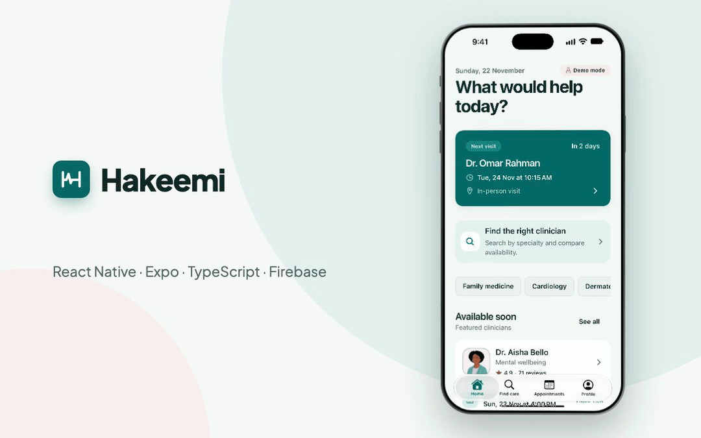
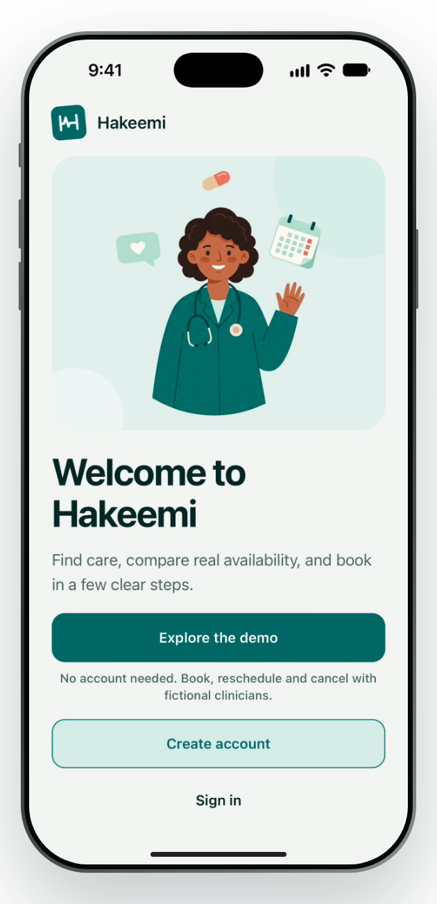
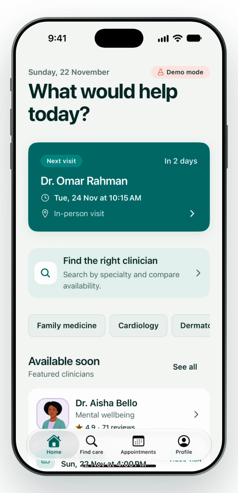
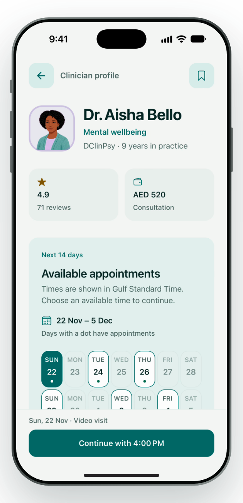
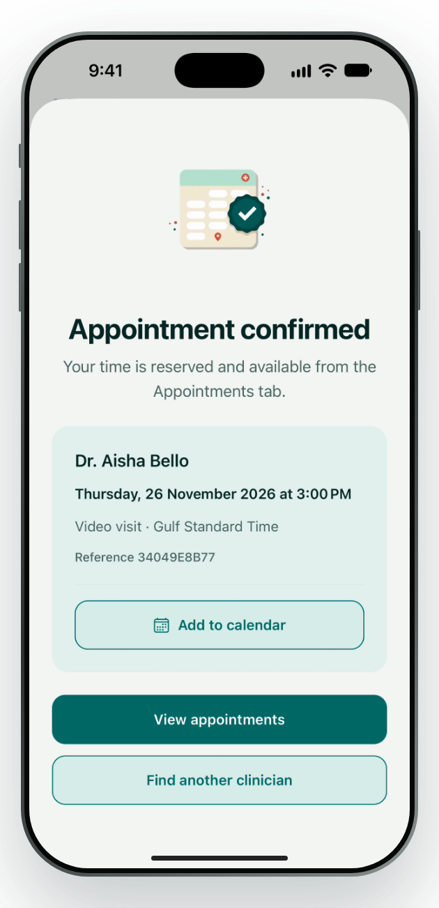
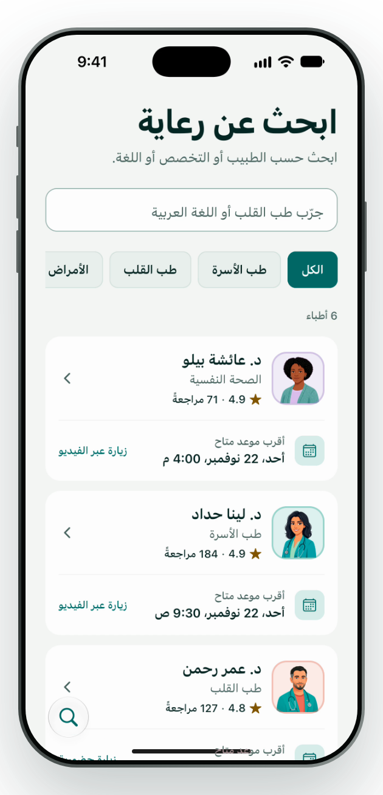
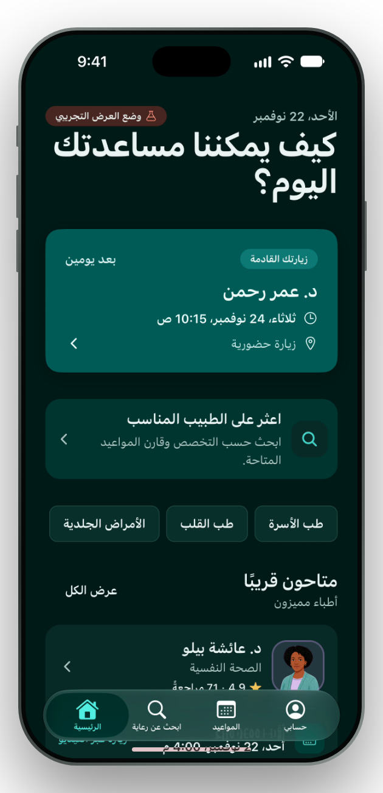
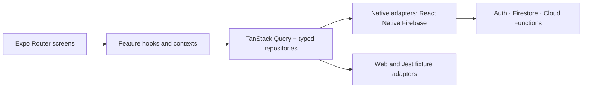

# Hakeemi

**A mobile app for finding a clinician and booking a visit — in English or Arabic, in light or dark mode, on iPhone and Android.**

Hakeemi is a portfolio project by [Nadir Alfakesh](https://naderalfakesh.com):
one person taking a product from design to a tested, working app. Every
clinician and appointment in it is fictional; it is not a healthcare service.

<p align="center">
  
</p>

<p align="center">
  <a href="docs/hakeemi-promo.mp4"><strong>▶ Watch the 80-second walkthrough with sound</strong></a>
</p>

## At a glance

- **A complete product, not a screen mock-up.** Sign-up, search, booking,
  rescheduling, cancelling, reminders and settings all work end to end.
- **Try it in seconds.** "Explore the demo" opens the full app without an
  account.
- **Truly bilingual.** One tap switches the whole app to Arabic, and every
  screen mirrors for right-to-left reading.
- **Built to be relied on.** Two people can never book the same time, the app
  keeps working on a poor connection, and it supports large text and screen-reader
  labels.
- **Tested like production software.** More than 250 automated tests run on
  every change.
- **One codebase, two platforms.** The same React Native code ships to iOS and
  Android.

## Screens

| Welcome                                                                                                              | Home                                                                                                                | Real availability                                                                                                              |
| -------------------------------------------------------------------------------------------------------------------- | ------------------------------------------------------------------------------------------------------------------- | ------------------------------------------------------------------------------------------------------------------------------ |
|  |  |  |

| Booking confirmed                                                                                                            | Arabic, right to left                                                                                                                   | Arabic in dark mode                                                                                               |
| ---------------------------------------------------------------------------------------------------------------------------- | --------------------------------------------------------------------------------------------------------------------------------------- | ----------------------------------------------------------------------------------------------------------------- |
|  |  |  |

## What you can do in it

- **Find care** — search clinicians by name, specialty or language, and
  filter by specialty.
- **See real availability** — each clinician shows the next two weeks of
  open times.
- **Book in two steps** — pick a time, review, confirm. The time is only
  reserved once the server confirms it.
- **Change your plans** — reschedule to another open time or cancel with a
  single clear confirmation.
- **Stay organised** — add a visit to your calendar and opt in to reminders.
- **Make it yours** — English or Arabic, light or dark, and a shortlist of
  saved clinicians that follows your account.

## How it is built

For engineers: the short version of what is under the hood.

| Area       | Choice                                                                        |
| ---------- | ----------------------------------------------------------------------------- |
| App        | React Native 0.88, React 19, Expo SDK 58, TypeScript (strict)                 |
| Navigation | Expo Router with typed routes and native tabs                                 |
| Backend    | Firebase Auth, Firestore, Cloud Functions, Security Rules, Cloud Messaging    |
| Data       | TanStack Query for server state, Zod validation at the Firestore boundary     |
| Forms      | React Hook Form with Zod schemas                                              |
| Quality    | Jest, React Native Testing Library, Firebase Emulator Suite, ESLint, Prettier |
| Build      | Expo development builds with Continuous Native Generation and EAS profiles    |



Decisions worth a look:

- **No double-booking.** Booking, rescheduling and cancelling run in Cloud
  Functions as Firestore transactions; clients can never write appointment
  state directly ([ADR 0003](docs/adr/0003-transactional-booking.md)).
- **Features own their code.** Each feature folder holds its UI, domain
  types, data access and tests. Platform SDKs sit behind adapters, so the same
  feature code runs on device, on the web and in Jest.
- **Right-to-left is native, not simulated.** Typed bilingual string
  catalogues, bilingual clinician data, CLDR plural rules and mirrored
  layouts; the theme choice also drives the system status bar and tab bar.
- **Offline-aware.** Cached reads keep the app useful without a connection
  ([ADR 0004](docs/adr/0004-offline-aware-caching.md)).
- **Accessible by default.** Dynamic Type up to 2×, 44 pt touch targets,
  screen-reader labels, reduced-motion support and contrast checks in the
  test suite.

**Tests:** `npm run validate` runs formatting, lint, strict type checks, 52
Jest suites with 245 tests, the Cloud Functions unit tests and Expo Doctor.
Firestore security rules and the booking, appointment-management, reminder
and notification-token Functions are tested against the Firebase Emulator
Suite, and CI runs all of it on every push. More in the
[testing strategy](docs/testing-strategy.md), the
[roadmap](docs/ROADMAP.md) and the [architecture decisions](docs/adr/).

```text
src/app/                 Expo Router routes
src/components/ui/       Accessible design-system primitives
src/features/            Feature-owned UI, domain, data, and tests
src/services/            Firebase initialization and query infrastructure
src/theme/               Tokens, themes, navigation theme, contrast checks
firebase/                Rules, indexes, seed catalogue, integration tests
functions/src/           TypeScript Cloud Functions and seed tooling
docs/                    Roadmap, ADRs, verification evidence, backend guide
```

## Run it locally

Everything runs against the Firebase Emulator Suite, so **no Firebase account
or credentials are needed**.

```sh
npm install
npm --prefix functions install
cp .env.example .env

# Terminal 1: local Firebase backend, seeded with the fictional catalogue
npm run firebase:emulators:seeded

# Terminal 2: build and run the app
npx expo prebuild --clean
npm run ios        # or: npm run android
```

<details>
<summary>Prerequisites, environment notes and commands</summary>

- Node.js 22.13+ (below 25) and npm.
- A Java runtime (JDK 17+) for the emulators.
- iOS: Xcode 27 with the iOS 27 SDK and CocoaPods.
- Android: Android Studio with an SDK and a JDK 17 to 21. Point `JAVA_HOME`
  at one of those rather than a newer JDK; the Android Gradle Plugin's CMake
  step aborts on the native-access warning that JDK 24+ prints.
- Expo Go is not supported; the app uses development builds.

`.env.example` enables emulator mode, so accounts, discovery, booking and
appointment management all work locally; only push-notification registration
needs a real Firebase project. Release bundles (preview and production) have
no defaults and stop at startup if a variable is missing or emulator mode is
requested, so a release build can never reach the emulators. To use your own
Firebase project, put its service files under `.firebase/development/` and
rebuild; the [Firebase development guide](docs/firebase-development.md) has
the details.

| Command                           | Purpose                                                    |
| --------------------------------- | ---------------------------------------------------------- |
| `npm start`                       | Start Metro for the Expo development client                |
| `npm run ios` / `npm run android` | Generate and run a native build                            |
| `npm run web`                     | Run the web build                                          |
| `npm test`                        | Run application tests                                      |
| `npm run firebase:rules:test`     | Verify Firestore and Storage authorization                 |
| `npm run validate`                | Run formatting, lint, strict types, tests, and Expo Doctor |

</details>

## Background

Hakeemi began in 2021 as a bare React Native 0.64 app, preserved under the
[`legacy-v1`](https://github.com/naderalfakesh/Hakeemi/tree/legacy-v1) tag.
This version is a full rebuild on a modern stack with a new interface and
original illustrations. The 2021 app followed a free
[Figma community design](https://www.figma.com/file/t9IGYhQmBToThHPtxJUuz5/Doctor-Appointment-App-Community?node-id=0%3A1),
which is kept as a reference only; the [legacy baseline](docs/legacy-baseline.md)
records the original audit.

## License

[MIT](LICENSE). Contributions follow [CONTRIBUTING.md](CONTRIBUTING.md).
