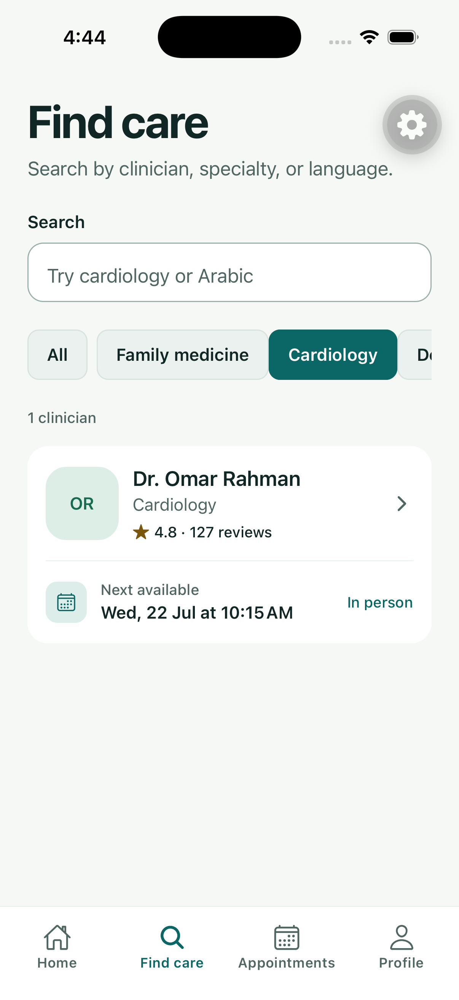
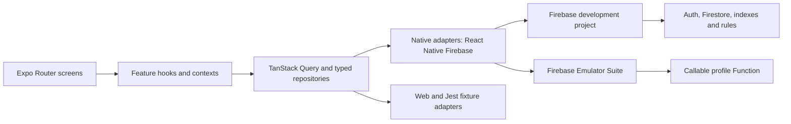

# Hakeemi

**A production-shaped React Native appointment experience, rebuilt from a 2021 portfolio app with modern Expo and Firebase architecture.**

> Hakeemi is a technical portfolio project. It uses fictional clinicians and
> patient data and is not a healthcare service or clinical product.

| Cloud-backed discovery                                                                                             | Provider details                                                                                                   | Account preferences                                                                                                                    |
| ------------------------------------------------------------------------------------------------------------------ | ------------------------------------------------------------------------------------------------------------------ | -------------------------------------------------------------------------------------------------------------------------------------- |
|  |  |  |

## The rebuild

The original Hakeemi was a bare React Native 0.64 application created in 2021.
This rebuild preserves that history in the
[`legacy-v1`](https://github.com/naderalfakesh/Hakeemi/tree/legacy-v1) tag while
replacing the implementation with Expo SDK 57, React Native 0.86, React 19.2,
TypeScript, Expo Router, and native Firebase SDKs.

This is not an Expo Go prototype. Hakeemi uses an Expo development build,
React Native Firebase, CocoaPods and Gradle native builds, Continuous Native
Generation (CNG), and explicit EAS build profiles. Expo removes unnecessary
generated-project maintenance without removing native capability. The full
trade-off and escape hatch are recorded in
[`ADR 0001`](docs/adr/0001-expo-cng.md).

The modernization is delivered as small, independently reviewable commits.
Phase 2 is complete and Phase 3 is in progress: the transaction-safe booking
backend is implemented and the guided mobile flow is next. See the
[roadmap](docs/ROADMAP.md) for the complete sequence.

## What works today

- Responsive onboarding and four-tab navigation built with typed Expo Router
  routes.
- Provider search, specialty filters, stable cursor pagination, and provider
  details backed by Firestore on native platforms.
- Email/password sign-up, sign-in, password recovery, verification handoff,
  sign-out, and cold-start session restoration.
- A callable Function that creates the authenticated user's server-owned
  profile idempotently.
- An authenticated, idempotent booking Function that prevents two requests from
  reserving the same slot in tested Firestore transactions.
- Owner-only language and theme preferences with optimistic updates, rollback,
  Firestore synchronization, and live dark-mode application.
- Deterministic fictional seed data, default-deny Firebase rules, composite
  indexes, and repeatable Emulator Suite tests.
- Explicit fixture adapters for Jest and the static web portfolio export; no
  native SDK is silently replaced on iOS or Android.

The booking UI, appointment management, Arabic RTL translation, notifications,
and calendar integration are planned work and are not presented as complete.

## Architecture



Feature code owns domain types and behavior; platform adapters own SDK details.
Zod validates Firestore data at the boundary, TanStack Query owns server state,
and route parameters contain stable serializable IDs. Authentication has one
application-level session owner instead of screen-level subscriptions.

The backend uses a separate development project,
`hakeemi-portfolio-dev`. The undocumented legacy Firebase project is
intentionally untouched. Cloud Functions and Storage remain emulator-only
until enabling Firebase billing is an explicit decision.

## Technology

| Area                 | Choice                                                                               |
| -------------------- | ------------------------------------------------------------------------------------ |
| Runtime              | Expo SDK 57, React Native 0.86, React 19.2, New Architecture                         |
| Navigation           | Expo Router with typed routes and static web export                                  |
| Native services      | React Native Firebase App, Auth, Firestore, and Functions                            |
| Server state         | TanStack Query with stable keys, retries, caching, and cursor pages                  |
| Forms and validation | React Hook Form and Zod                                                              |
| Backend              | Firebase Auth, Firestore, Cloud Functions, Security Rules, Emulator Suite            |
| Quality              | Strict TypeScript, Jest, React Native Testing Library, ESLint, Prettier, Expo Doctor |
| Native lifecycle     | Expo CNG, config plugins, development builds, and EAS profiles                       |

## Quality evidence

The current milestone has been exercised beyond unit tests:

- iOS CNG development build: successful, with native Firebase modules linked.
- Android arm64 debug APK: successful.
- Static web export: 17 routes generated.
- Application tests: 20 suites and 50 tests passing.
- Firebase authorization: 13 Emulator Suite rules tests passing.
- Callable integration: Auth, Firestore, and Functions emulators passing.
- Strict type checks: application, Firebase tooling, and Functions passing.
- Expo Doctor: 20/20 checks passing.

The [Phase 2 verification record](docs/phase-2-verification.md) includes the
tested flows, environment boundaries, cleanup, screenshots, and known
non-blocking warnings. [Phase 1 evidence](docs/phase-1-verification.md) records
the rebuilt UI foundation and native baseline.

## Project structure

```text
src/app/                 Expo Router routes
src/components/ui/       Accessible design-system primitives
src/features/            Feature-owned UI, domain, data, and tests
src/services/            Firebase initialization and query infrastructure
src/theme/               Tokens, themes, navigation theme, contrast checks
firebase/                Rules, indexes, seed catalogue, integration tests
functions/src/           TypeScript callable backend and seed tooling
docs/                    Roadmap, ADRs, verification evidence, backend guide
```

## Run locally

### Prerequisites

- Node.js 22.13 or newer and earlier than 25
- npm
- Xcode and CocoaPods for iOS development
- Android Studio, an Android SDK, and a compatible JDK for Android development

Install both workspaces and validate the repository:

```sh
npm install
npm --prefix functions install
cp .env.example .env
npm run validate
```

Native Firebase service files are deliberately not committed. Place your
development files at `.firebase/development/GoogleService-Info.plist` and
`.firebase/development/google-services.json`, or provide their paths through
the environment variables documented in `.env.example`.

Generate and run a native development build:

```sh
npx expo prebuild --clean
npm run ios
# or
npm run android
```

Start Metro for an existing development client with `npm start`. Expo Go is not
a supported runtime after React Native Firebase is linked.

### Firebase emulators

Start the local services in one terminal:

```sh
npm --prefix functions run build
npm run firebase:emulators
```

Seed fictional provider data from another terminal:

```sh
npm run firebase:seed:emulator
```

Use the reserved `demo-hakeemi` emulator project for automated tests. Cloud
commands must always name `hakeemi-portfolio-dev` explicitly; the repository
does not contain a `.firebaserc`. The
[Firebase development guide](docs/firebase-development.md) documents service
ports, deployment safeguards, native configuration, and the billing boundary.

## Useful commands

| Command                           | Purpose                                                    |
| --------------------------------- | ---------------------------------------------------------- |
| `npm start`                       | Start Metro for the Expo development client                |
| `npm run ios` / `npm run android` | Generate and run a native build                            |
| `npm run web`                     | Run the static-compatible web portfolio build              |
| `npm test`                        | Run application tests                                      |
| `npm run firebase:rules:test`     | Verify Firestore and Storage authorization                 |
| `npm run firebase:profile:test`   | Verify the authenticated callable integration              |
| `npm run validate`                | Run formatting, lint, strict types, tests, and Expo Doctor |

## Historical context

The 2021 app was based on a free
[Doctor Appointment App Community design](https://www.figma.com/file/t9IGYhQmBToThHPtxJUuz5/Doctor-Appointment-App-Community?node-id=0%3A1).
Its visual assets are reference-only because no license was retained in the
repository. The modern interface and screenshots are newly implemented; the
[legacy baseline](docs/legacy-baseline.md) records provenance, recovery, and
the original architecture audit.
