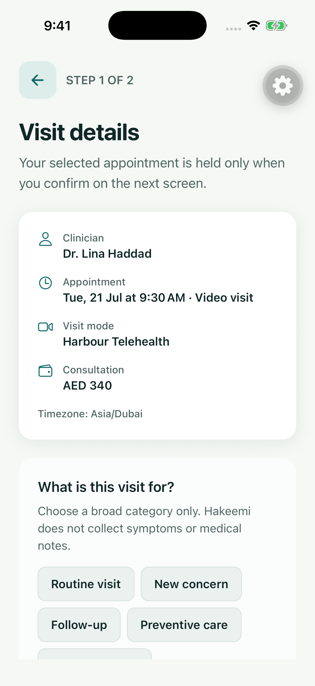
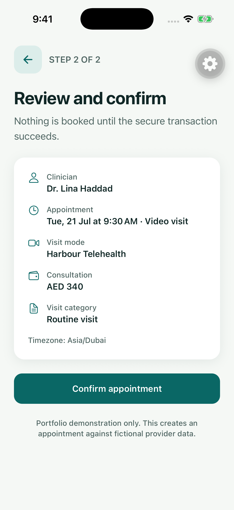
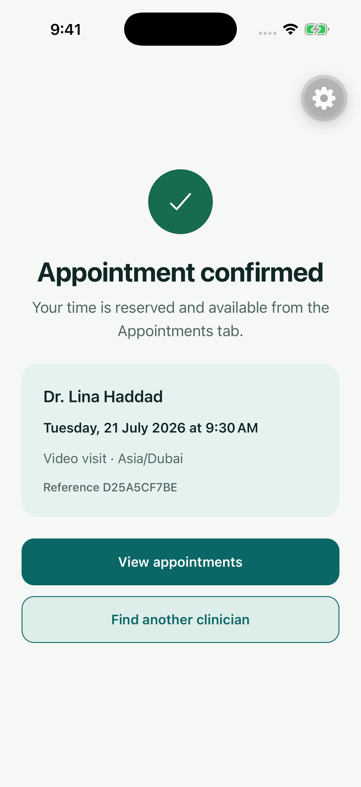
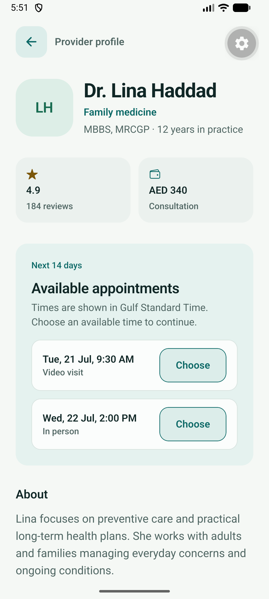

# Phase 3 Verification

> Verified: 2026-07-20
>
> Final implementation commit: `b05f2b0`
>
> Interactive emulator identity correction: `406ee71`
>
> Scope: transactional booking, safe draft restoration, confirmation, and the
> authenticated Appointments surface

## Outcome

Phase 3 passes its definition of done. An authenticated patient can select one
real available slot, retain the safe booking draft through authentication,
review visit mode and timezone, confirm through a server-owned Firestore
transaction, and see the durable appointment after a process restart.

The mobile client never writes slot or appointment lifecycle state directly. It
sends only the slot ID, a broad reason category, and an idempotency key to the
authenticated `bookAppointment` callable. The Function derives patient identity
from Auth and commits the appointment and slot transition atomically.

## Native end-to-end evidence

### iOS booking journey

The iPhone 17 Pro simulator on iOS 26.5 completed this journey through the
rendered UI and accessibility tree against the local Auth, Firestore, and
Functions emulators:

1. Launch a freshly rebuilt Expo development client with AsyncStorage, Expo
   Crypto, Expo Network, and React Native Firebase linked natively.
2. Continue as a guest, open Find Care, and receive all 6 fictional clinicians.
3. Open Dr. Lina Haddad and receive two ordered slots in the 14-day window.
4. Select the 21 July video visit while signed out and reach the authentication
   boundary without losing the slot selection.
5. Create a disposable fictional account, complete the emulator verification
   state, and continue directly into Visit Details.
6. Choose the broad `Routine visit` category. No symptoms, notes, or free-form
   medical text are collected.
7. Review the clinician, time, video visit mode, clinic, price, and
   `Asia/Dubai` timezone before submission.
8. Confirm once. The callable received a valid Auth context and returned a
   deterministic appointment reference after the transaction succeeded.
9. Open Appointments and see the confirmed visit for the signed-in owner.
10. Terminate and relaunch the app process, reopen Appointments, and see the
    same confirmed visit restored from Firestore.

| Safe visit details                                  | Transaction review                                      |
| --------------------------------------------------- | ------------------------------------------------------- |
|  |  |

| Durable confirmation                                             | Owner Appointments tab                                             |
| ---------------------------------------------------------------- | ------------------------------------------------------------------ |
|  |  |

The resulting emulator document was independently inspected before cleanup:

- `status=confirmed`
- `patientId` matched the Auth user's UID
- `providerId=lina-haddad`
- `slotId=lina-video-early`
- `reasonCategory=routine_visit`
- `visitMode=video`
- `timezone=Asia/Dubai`

### Android smoke

The current native tree also built and installed on the arm64
`Medium_Phone_API_36.1` emulator. App version 2.0.0 targeted API 36, loaded the
six-clinician emulator catalogue, opened Dr. Lina Haddad, and rendered both
availability rows with accessible Choose actions. This verifies that the new
native storage, UUID, and network modules link on Android as well as iOS.

## Backend and authorization evidence

The isolated `demo-hakeemi` suites passed after the native journey:

- 6 callable integration tests cover atomic success and replay, simultaneous
  contention, booking-window bounds, provider ownership, missing slots, forged
  patient fields, and anonymous access.
- 14 Firestore and Storage rules tests cover public discovery, available-slot
  visibility, server-only lifecycle writes, owner-only appointments, private
  user data, and default-deny fallbacks.
- 7 Functions unit tests cover booking contracts and idempotent profile
  behavior.

Two simultaneous callable requests produced exactly one reservation. Replaying
the winning request returned the same appointment; changing the payload behind
the same idempotency key was rejected. Direct mobile writes to appointments and
availability transitions remained denied.

## Offline and retry behavior

- Booking checks current connectivity immediately before invoking the callable.
- An offline attempt never enters the mutation service and is not queued.
- Only provider ID, slot ID, broad reason category, request UUID, and expiry are
  stored in the local draft; no credentials or medical notes are persisted.
- The request UUID survives authentication and restart so an uncertain retry is
  idempotent.
- The confirmation route reads the owner appointment from Firestore rather than
  trusting only transient mutation output.

Focused mobile tests cover draft expiry/restoration, offline submission,
validated online submission, appointment mapping, and details/review/
confirmation states.

## Build and quality evidence

| Check                        | Result                                                         |
| ---------------------------- | -------------------------------------------------------------- |
| iOS native build             | Expo CNG debug build; 0 errors, 4 generated-project warnings   |
| iOS native E2E               | Full authenticated booking and cold-process restoration passed |
| Android native build/smoke   | API 36.1 arm64 debug APK built, installed, and loaded slots    |
| Static web export            | 20 routes exported, including all three booking routes         |
| Application tests            | 26 Jest suites, 62 tests passed                                |
| Functions unit tests         | 7 tests passed                                                 |
| Booking callable integration | 6 tests passed                                                 |
| Firestore/Storage rules      | 14 tests passed                                                |
| TypeScript                   | App, Firebase tooling, and Functions strict checks passed      |
| Lint and formatting          | Passed                                                         |
| Expo Doctor                  | 20/20 checks passed                                            |

`npm audit --omit=dev` reports 15 moderate advisories and no high or critical
advisories. The findings remain in Expo and React Native Firebase dependency
chains; automatic remediation would require incompatible dependency changes.

## Cleanup and environment correction

Native proof found and fixed an interactive-emulator identity mismatch: the
service files identify `hakeemi-portfolio-dev`, while the old interactive
scripts seeded `demo-hakeemi`. Interactive commands now use the native project
identity so Auth, Firestore, Functions routes, and seed data share one local
namespace. Automated authorization and contention tests retain the safer
synthetic `demo-hakeemi` identity.

After verification, the exact disposable Auth user, profile, preference data,
and appointment were deleted. The deterministic seed was reapplied. A final
inspection returned zero Auth users, zero appointments, and the tested slot at
`status=available`, `appointmentId=null`, and `version=1`.

No legacy Firebase data was read or changed. Cloud Functions and Storage remain
emulator-only because the development project is not on the Blaze plan.

## Non-blocking warnings

- The iOS generated project reports duplicate C++ and dependency-analysis
  warnings from Expo, CocoaPods, and React Native Firebase build phases.
- Android reports an upstream AsyncStorage manifest namespace warning and
  Gradle deprecation notices.
- The Functions emulator used host Node 26 while the deployable runtime contract
  remains Node 22.
- Jest reports a local Watchman recrawl warning.

None of these warnings originates in Hakeemi booking logic or invalidates the
verified transaction and owner-isolation properties.
